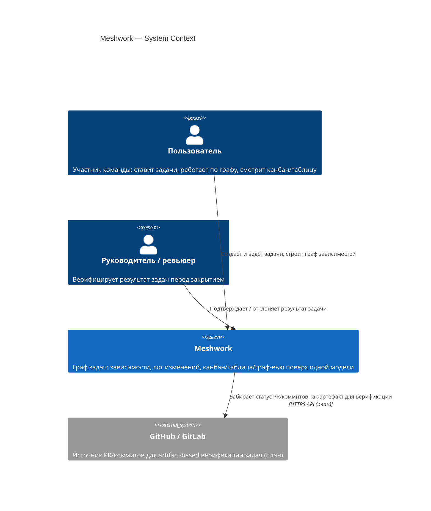
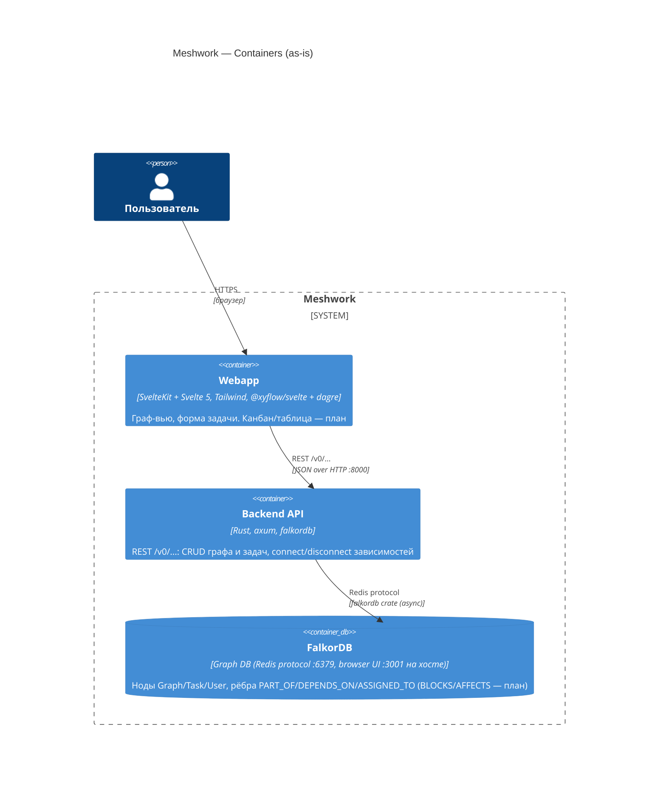
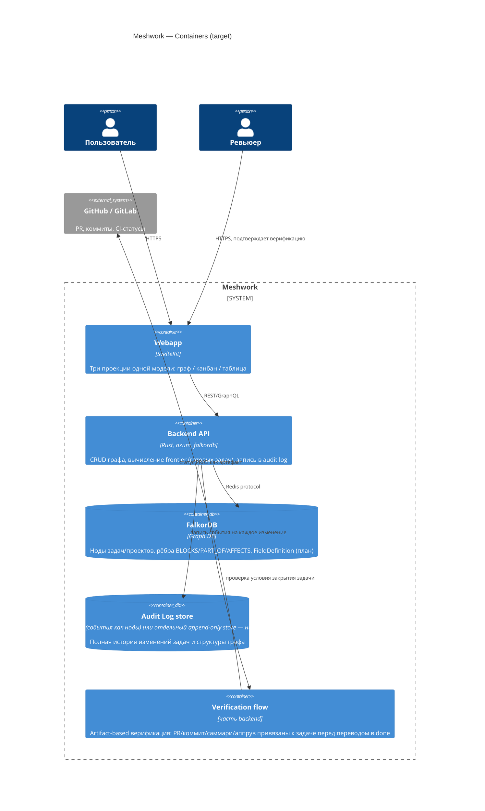

# Meshwork — Architecture (C4)

Срез архитектуры на текущий момент (ветка `falkordb`, бэкенд переезжает на
Rust). Не путать с [MISSION.md](../MISSION.md) — там продуктовое видение,
здесь — как оно устроено технически. Диаграммы будут расходиться с кодом
по мере разработки, актуализировать по факту значимых изменений.

## Level 1 — System Context

Кто вообще взаимодействует с системой.

## Level 2 — Containers

Что из чего физически состоит сейчас.

## Level 2 — Containers (целевое, по MISSION.md)

Куда движемся: те же контейнеры, плюс то, что нужно под прозрачность и
верификацию из [MISSION.md](../MISSION.md).

## Открытые архитектурные вопросы

- **Audit log**: писать события как ноды/рёбра в той же FalkorDB (просто, но
  разрастает граф и мешает основным обходам) или в отдельный append-only
  store, синхронизированный по `task_id`? Не решено.
- **Кастомные поля**: отложено см. [MISSION.md § Открытые вопросы](../MISSION.md).
  Если решится в пользу произвольных полей — вероятно, `FieldDefinition`
  ноды на уровне проекта (см. обсуждение), без отдельной document DB.
